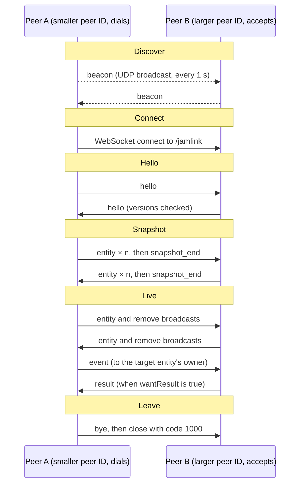

# Jamlink Protocol v1.0

A peer-to-peer LAN protocol for connecting independent games.

## Overview

Jamlink lets independently built games on the same LAN share one world: each game owns its own entities, sees everyone else's, and affects them only by sending events to their owner. There is no server, host or coordinator. Every game is an equal peer in a full mesh of WebSocket connections carrying JSON.

Design principles:

- **Pure peer-to-peer.** Every peer runs a WebSocket server and dials every other peer. No peer has a special role, so any peer can leave at any time without breaking the session.
- **Single owner per entity.** Only the owner of an entity changes its state. Everyone else holds a read-only replica.
- **Interact by asking.** To affect another game's entity, send an event to its owner. The owner applies its own rules and may ignore the request.
- **No global state.** Everything shared is an owned entity. Join-in-progress works because every live entity has a live owner who can describe it.
- **Small core, open extension.** A few fields every game understands, plus a free-form `ext` object. Unknown fields, kinds and events are ignored, never fatal.
- **Easy in any engine.** WebSocket, JSON and UDP broadcast are all a game needs.

The key words MUST, SHOULD and MAY are used as in RFC 2119.

Companion files for coding agents: [`template/AGENTS.md`](template/AGENTS.md) goes into every game repo, and [`template/jamlink.schema.json`](template/jamlink.schema.json) validates every message.

## Conventions

The world uses SI units and glTF axes: metres, seconds, radians, right-handed, +Y up, with -Z as north. Every game converts to these on send and from them on receive.

### Units

| Quantity | Unit | Notes |
| --- | --- | --- |
| Distance, position | metre | Floats |
| Velocity | metre per second | Floats |
| Angle | radian | Floats |
| Duration (in event data) | second | Floats |
| Timestamp `t` | millisecond | Integer, sender's own clock (see Time) |
| Mass | kilogram | Optional, only if a game uses physics |
| Colour | `"#rrggbb"` | Lowercase hex string |

### Coordinate system

- Right-handed, **+Y up**, same as glTF, Godot 3D and Bevy.
- The ground is the XZ plane at y = 0.
- Compass: **+X is east, -Z is north**, +Z is south, -X is west.
- The origin is the shared centre of the world. Games SHOULD spawn their content near it unless they have a reason not to.
- Vectors are JSON arrays `[x, y, z]`.

### Rotation

- `yaw` is the core orientation field: radians about +Y. **0 faces north (-Z).** Positive turns counter-clockwise seen from above, so π/2 faces west and -π/2 faces east.
- `rot` is an optional full orientation for 3D games: a unit quaternion `[x, y, z, w]` in glTF order. If both are present, `rot` wins and `yaw` MUST match its heading.

### 2D games

Top-down 2D games live on the ground plane. They send `y = 0` and MAY ignore received `y`, or use it for draw order. Pixel-based games pick their own pixels-per-metre (32 or 64 is typical) and divide by it on send.

### Engine mapping

| Engine or space | Native axes | Native → Jamlink position | Native → Jamlink yaw |
| --- | --- | --- | --- |
| Godot 3D, Bevy | Right-handed, Y-up, metres, -Z forward | Identical | Identical |
| Unity 3D | Left-handed, Y-up, metres, +Z forward | `(x, y, -z)` | `-radians(eulerY)` |
| Unreal | Left-handed, Z-up, centimetres, X forward | `(Y/100, Z/100, -X/100)` | `-radians(Yaw)` |
| 2D, screen y down (Godot 2D, most pixel frameworks) | x right, y down, pixels | `(x/ppm, 0, y/ppm)` | `-angle - π/2` if 0 rad faces +x on screen |
| 2D, y up (Unity 2D) | x right, y up, units | `(x, 0, -y)` | `angle - π/2` if 0 rad faces +x |

Convert back with the inverse. Test the mapping once with a peer in another engine: walk north and check that you appear to move north for them.

### Scale reference

Shared reference sizes keep games looking compatible next to each other:

- A human-sized character is about 1.8 m tall with a 0.4 m radius.
- Walking is about 1.5 m/s, running 4–6 m/s.
- Grid-based games (RTS, building) use a 1 m grid.
- Games SHOULD handle any finite position, but most content should stay within 500 m of the origin.

### Time

Each peer stamps entity updates with `t`: integer milliseconds on its own monotonic clock, for example time since the game started. Values from different peers are never compared. A receiver uses `t` only to order and interpolate updates from that one sender. This removes any need for clock synchronisation.

### Identifiers

- **Peer ID:** 16 lowercase hex characters, random, generated at every startup. Example: `"3fa9c0d27b1e4a68"`.
- **Entity ID:** `"<peerId>:<n>"`, where `n` is a counter starting at 1. Never reused within a run, even after the entity is removed.
- **Event ID:** `"<peerId>:e<n>"`, from a separate counter.

IDs are opaque strings to receivers. After an ownership transfer the ID stays the same, so a receiver MUST use the `owner` field, not the ID prefix, to find the owner.

### JSON style

- One JSON object per WebSocket text frame, UTF-8.
- Every message has a `type` field.
- Keys are camelCase. Enumerated values (`kind`, `event`, `reason`) are lowercase snake_case.
- Numbers MUST be finite. No `NaN` or `Infinity`.

## Transport and discovery

Peers find each other with UDP broadcast beacons, then form a full mesh with exactly one WebSocket connection per pair, dialled by the peer with the smaller peer ID.

### Ports

| Use | Protocol | Port |
| --- | --- | --- |
| Discovery beacons | UDP broadcast | 45800 (fixed) |
| Game connections | WebSocket (TCP) | 45801 by default; if taken, the next free port up to 45809 |

The WebSocket endpoint is `ws://<host>:<port>/jamlink`. A peer SHOULD offer the WebSocket subprotocol `jamlink.1` but MUST NOT require it, since some engine clients cannot set subprotocols. The version in `hello` is authoritative.

### Beacons

Every peer broadcasts a beacon to `255.255.255.255:45800` once per second:

```json
{"type": "beacon", "protocol": "jamlink", "version": "1.0", "peerId": "3fa9c0d27b1e4a68", "name": "Goblin Farm", "port": 45801}
```

- The receiver takes the host from the packet's source address, not from the payload. Machines often have several network interfaces, and the source address is the one that works.
- A peer ignores its own beacons and beacons with a different `protocol` or major version.
- Beacons only announce. They never carry game state.

### Manual seeds

Every game MUST also accept a list of `host:port` seed addresses, for example from a config file or command-line argument. Seeds cover networks that block broadcast and several games on one machine. Binding UDP 45800 from several processes on one machine needs `SO_REUSEADDR`, which not every engine exposes, so local testing usually runs on seeds such as `127.0.0.1:45802`.

### Forming the mesh

1. **Dial rule.** When a peer learns of another peer by beacon or gossip, it dials only if its own peer ID is smaller (plain string comparison). Otherwise it waits to be dialled.
2. **Fallback.** If a known peer with a smaller ID has not connected within 5 seconds, dial it anyway. This covers one-way firewalls and missed beacons.
3. **Seeds** are always dialled, since their peer ID is unknown until `hello`.
4. **Duplicates.** If two open connections to the same peer exist after `hello`, keep the one dialled by the smaller peer ID and close the other with close code 4001.
5. **Self-connections** (a seed that turns out to be yourself) are closed with code 4002.

### Gossip

Each `hello` carries the sender's list of connected peers, and a peer sends a `peers` message to all connections whenever a connection opens. A peer that learns of a peer it is not connected to applies the dial rule. Reaching any one peer is therefore enough to join the whole mesh.

### Sending

- **Broadcast** = send the same message on every open connection. Entity updates, removals, chat and transfers are broadcast.
- **Direct** = send on the one connection to the target peer. Events, results and transfer offers are direct.

WebSocket runs over TCP, so messages on one connection arrive in order and are never lost while it is open. There is no ordering between different connections.

## Session lifecycle

Every connection runs the same symmetric sequence: both sides send `hello`, then a snapshot of the entities they own, then live updates until one side says `bye` or goes silent.



The snapshot is what makes join-in-progress work: each side describes everything it owns before the live phase begins.

### Hello

Both sides send `hello` as their first message, as soon as the connection opens:

```json
{
  "type": "hello",
  "protocol": "jamlink",
  "version": "1.0",
  "peerId": "3fa9c0d27b1e4a68",
  "name": "Goblin Farm",
  "team": "Team Gob",
  "faction": "goblin_farm",
  "port": 45801,
  "handles": ["damage", "heal", "interact", "take"],
  "peers": [
    {"peerId": "7c01d9e4f2a83b55", "host": "192.168.1.23", "port": 45801}
  ]
}
```

| Field | Required | Meaning |
| --- | --- | --- |
| `protocol` | Yes | Always `"jamlink"` |
| `version` | Yes | `"major.minor"`, see Versioning |
| `peerId` | Yes | The sender's peer ID |
| `name` | Yes | Human-readable game name, shown in UIs and logs |
| `team` | No | Who made the game |
| `faction` | Yes | The game's own faction: lowercase snake_case, usually the game name. Fixed for the game, so it survives restarts |
| `port` | Yes | The sender's WebSocket server port, for gossip |
| `handles` | No | Standard and custom events this game acts on. A hint for UIs, not a promise |
| `peers` | Yes | Peers the sender is connected to, with host as the sender sees it. May be empty |

A peer MUST NOT send anything else until it has received and accepted the other side's `hello`. On a major version mismatch it sends an `error` with code `version_mismatch` and closes with code 4003.

### Snapshot (join-in-progress)

After the hello exchange, each side sends one `entity` message for every entity it currently owns, followed by `snapshot_end`:

```json
{"type": "snapshot_end", "count": 42}
```

A joining peer receives one snapshot per connection, and since every live entity has a connected owner, the union of those snapshots is the whole world. Peers it connects to later simply add their part when they arrive. Until `snapshot_end` arrives from a peer, a game MAY treat that peer's part of the world as still loading. Live updates sent during the snapshot are valid and are applied normally.

### Live phase

After the snapshot, peers exchange `entity`, `remove`, `event`, `result`, `chat`, `peers`, the transfer messages and `heartbeat` as needed. Each is described in the sections below.

### Leaving

- **Graceful:** send `bye` on every connection, then close each with code 1000. A peer that wants some entities to outlive it transfers them first (see Ownership).
- **Ungraceful:** the connection closes, or nothing arrives on it for 5 seconds.

Either way, every other peer then removes all entities owned by the departed peer, and cancels pending transfers and events involving it. Entities it transferred away earlier are unaffected.

### Reconnecting

A game that restarts generates a new peer ID and joins as a new peer. A peer whose connection drops while the game keeps running reconnects with the same peer ID and sends `hello` and a full snapshot again. Receivers already removed its entities when the connection dropped, so the snapshot simply recreates them.

## Ownership

The owner of an entity is the only peer that may change it; everyone else asks the owner through events, and ownership moves only through an explicit handshake.

### Rules

1. Every entity has exactly one owner: the peer named in its `owner` field. At creation this is the peer that created it.
2. Only the owner sends `entity` and `remove` messages for it.
3. A receiver applies an `entity` or `remove` only when the sending connection's peer is the entity's current owner. For an entity it has not seen before, the message's `owner` field MUST equal the sender. Anything else is ignored.
4. To change another peer's entity, send an event to its owner (see Events). The owner applies its own rules and may decline.
5. Owners SHOULD honour reasonable requests in the spirit of the jam: if someone hits your goblin, it should take damage.

### Transferring ownership (optional)

Transfers let entities change hands: an item picked up and dropped elsewhere, a unit given to another player, or loot left behind when a game quits.

**Offering and accepting transfers is OPTIONAL in 1.0.** A peer that does not implement them simply ignores `transfer_offer`, and the offering peer treats the silence as a decline after 5 seconds. Every peer MUST still apply incoming `transfer` messages (step 4), because that only means updating one `owner` field, and skipping it would make the peer ignore the new owner's updates.

1. The owner A sends `transfer_offer` directly to peer B:

   ```json
   {"type": "transfer_offer", "id": "3fa9c0d27b1e4a68:17"}
   ```

2. B replies directly with `transfer_reply`. No reply within 5 seconds counts as a decline.

   ```json
   {"type": "transfer_reply", "id": "3fa9c0d27b1e4a68:17", "accept": true}
   ```

3. On accept, A broadcasts `transfer` to every peer, including B, and stops sending updates for the entity:

   ```json
   {"type": "transfer", "id": "3fa9c0d27b1e4a68:17", "from": "3fa9c0d27b1e4a68", "to": "7c01d9e4f2a83b55"}
   ```

4. Every peer applies `transfer` only when it comes from the current owner, then sets the entity's owner to B.
5. When B receives `transfer`, it owns the entity. It MUST broadcast a full `entity` update with `owner` set to itself straight away and again 1 second later. The repeat covers peers that received B's first update before A's `transfer` and therefore ignored it.

Rules for edge cases:

- An owner has at most one open offer per entity. While an offer is open, it keeps sending updates as normal.
- The entity ID never changes, so the ID prefix may no longer match the owner.
- A quitting game transfers what should outlive it before sending `bye`. Any peer that accepts can adopt the leftovers. Without a coordinator, a quitting game picks the recipient itself, for example the peer whose player is nearest.

## Entities

An entity is anything one game puts into the shared world, described by a small core every game understands plus an `ext` object for game-specific data. Each `entity` message carries the **complete current state** and replaces the receiver's replica: an optional field left out means its default, not "unchanged".

```json
{
  "type": "entity",
  "id": "3fa9c0d27b1e4a68:42",
  "owner": "3fa9c0d27b1e4a68",
  "kind": "creature",
  "subkind": "goblin",
  "t": 183245,
  "pos": [12.5, 0, -4.0],
  "vel": [1.2, 0, 0],
  "yaw": -1.571,
  "radius": 0.4,
  "height": 1.2,
  "hp": 35,
  "hpMax": 50,
  "faction": "hostile",
  "name": "Grumpy goblin",
  "state": "moving",
  "tags": ["solid"],
  "display": {"color": "#c0392b", "shape": "capsule"},
  "ext": {"goblinMood": "angry"}
}
```

### Fields

| Field | Required | Type | Default | Meaning |
| --- | --- | --- | --- | --- |
| `id` | Yes | string | | Entity ID |
| `owner` | Yes | string | | Owner's peer ID |
| `kind` | Yes | string | | One of the core kinds below |
| `t` | Yes | integer | | Owner's timestamp in ms |
| `pos` | Yes | [x, y, z] | | Position of the entity's base, in metres |
| `vel` | No | [x, y, z] | [0, 0, 0] | Velocity in m/s, used for extrapolation |
| `yaw` | No | number | 0 | Heading in radians, 0 = north |
| `rot` | No | [x, y, z, w] | | Full orientation; wins over `yaw` |
| `radius` | No | number | 0.5 | Footprint radius in metres |
| `height` | No | number | 1.0 | Height in metres |
| `subkind` | No | string | | Free-form species or type, e.g. `"goblin"`, `"wood"`, `"campfire"` |
| `name` | No | string | | Display name |
| `hp`, `hpMax` | No | number | | Present means the entity can be damaged |
| `faction` | No | string | `"neutral"` | See Factions |
| `state` | No | string | `"idle"` | Current activity, see States |
| `qty` | No | integer | 1 | Stack size, for items and resources |
| `tags` | No | string[] | [] | Capability flags, see Tags |
| `display` | No | object | | Rendering hints, see Display hints |
| `ext` | No | object | | Game-specific data; others may ignore it |

### Kinds

| Kind | Use for |
| --- | --- |
| `player` | A character controlled by a human at the owning game |
| `npc` | An AI character that is not hostile by default: villagers, traders, pets |
| `creature` | An AI character that is usually wildlife or an enemy |
| `item` | A loose object that can be picked up; `subkind` names it, `qty` counts it |
| `resource` | A harvestable node such as a tree, rock or ore vein |
| `structure` | Something built or placed: walls, buildings, campfires, chests |
| `projectile` | A short-lived moving object: arrows, spells, thrown rocks |
| `marker` | Something non-physical: a waypoint, a zone (sized by `radius`) or a map ping |

A receiver that does not recognise a `kind` treats the entity as a `marker` and draws it from its display hints. New kinds go through a minor version (see Versioning). Until then, use the closest core kind plus `subkind`.

No kind is mandatory. A city-builder style game may own no `player` at all, only structures, NPCs and items, and act on other games purely through events sent from its own UI. Events from such a game simply leave out `source`.

### Common subkinds

These lowercase names let items and resources move between games meaningfully: `wood`, `stone`, `iron`, `gold`, `food`, `water`, `fibre`, `coin`. Others are allowed. A game that does not know a subkind MAY still accept it as a generic item.

### Factions

| Faction | Meaning |
| --- | --- |
| A game's own faction, e.g. `goblin_farm` | That game's side: its players, units and buildings. Each game names it in `hello` |
| `hostile` | Wild enemies that attack every game's side |
| `neutral` | Attacks nobody and is not a default target |

PvP between games is allowed. Each game decides how it treats other games' factions: attack, trade or ignore. A game MAY use extra factions of its own, prefixed with its faction name, for example `goblin_farm.rebels`. Games treat any faction they do not know as another game's side.

### States

Suggested values: `idle`, `moving`, `attacking`, `working`, `stunned`, `dead`. Receivers use them for animation hints only. A game MAY keep a dead entity around with `state: "dead"` and `hp: 0`, for example as a corpse to loot.

### Tags

| Tag | Meaning |
| --- | --- |
| `solid` | Blocks movement; other games SHOULD collide with it |
| `pickup` | Accepts the `take` event |
| `interactable` | Accepts the `interact` event |
| `commandable` | Accepts the `command` event from other peers |
| `invulnerable` | Ignores `damage`; others need not bother sending it |

### Display hints

Hints let any game draw any entity without knowing it:

```json
"display": {"color": "#c0392b", "shape": "capsule", "label": "Goblin"}
```

- `color`: `"#rrggbb"`.
- `shape`: `capsule`, `box`, `sphere`, `cylinder`, `cone` or `flat` (a disc on the ground). 2D games draw a circle for round shapes and a square for `box`.
- `label`: short text to draw above it. Defaults to `name`.

The fallback rendering is the shape, sized by `radius` and `height`, in the given colour, with the label above. Games are free to draw known subkinds with their own art instead.

### Removal

The owner broadcasts `remove` when an entity leaves the world:

```json
{"type": "remove", "id": "3fa9c0d27b1e4a68:42", "reason": "destroyed"}
```

| Reason | Meaning |
| --- | --- |
| `destroyed` | Killed or broken. Receivers MAY play a death or break effect |
| `taken` | Picked up by someone. Receivers MAY play a pickup effect |
| `despawned` | Quietly gone. No effect |

## Events

An event is a request sent directly to the owner of a target entity; the owner decides what happens, and the visible outcome arrives through the owner's normal `entity` and `remove` broadcasts.

```json
{
  "type": "event",
  "eventId": "7c01d9e4f2a83b55:e9",
  "event": "damage",
  "target": "3fa9c0d27b1e4a68:42",
  "source": "7c01d9e4f2a83b55:1",
  "data": {"amount": 12, "damageType": "physical"},
  "wantResult": false
}
```

| Field | Required | Meaning |
| --- | --- | --- |
| `eventId` | Yes | Event ID, unique per sender |
| `event` | Yes | Event name: a standard event below, or a custom one |
| `target` | Yes | Entity ID the event acts on |
| `source` | No | Entity that caused it, e.g. the attacker. Used for aggro and credit |
| `data` | No | Event-specific parameters. Defaults to `{}` |
| `wantResult` | No | When `true`, the owner MUST reply with a `result`. Defaults to `false` |

The sender sends the event on its connection to the target's current owner. A peer that receives an event for an entity it does not own (for example right after a transfer) does not forward it. It replies with `not_owner` if a result was wanted, and otherwise drops it.

### Results

```json
{"type": "result", "eventId": "7c01d9e4f2a83b55:e9", "ok": true, "data": {"subkind": "wood", "qty": 3}}
```

| Field | Meaning |
| --- | --- |
| `eventId` | The event being answered |
| `ok` | Whether the owner applied the event |
| `reason` | When `ok` is false: `declined`, `not_owner`, `unknown_target` or `unsupported` |
| `data` | Event-specific reply data |

A sender that wanted a result and gets none within 5 seconds treats the event as declined.

### Standard events

| Event | `data` | Owner's expected behaviour | Result |
| --- | --- | --- | --- |
| `damage` | `amount` (number), `damageType` (optional: `physical`, `fire`, `cold`, `poison`, `magic`) | Reduce `hp`, applying its own armour or resistances | Not needed |
| `heal` | `amount` (number) | Increase `hp` up to `hpMax` | Not needed |
| `push` | `impulse` ([x, y, z] in m/s) | Add the impulse to the entity's velocity, e.g. knockback | Not needed |
| `status` | `effect` (e.g. `slow`, `stun`, `burn`, `poison`), `duration` (seconds), `strength` (optional, 0–1) | Apply the effect if the game supports it | Not needed |
| `interact` | `verb` (optional, default `use`) | Open, talk, toggle, trade. Reply data MAY carry `text` to show the player | Optional |
| `take` | `qty` (optional, default all) | For an `item`: remove it with reason `taken`, or reduce `qty`. For a `resource`: harvest it. Reply with what was taken | Always send `wantResult: true` |
| `give` | `subkind`, `qty`, `ext` (optional) | Add the goods to the target, such as a player's inventory or a storage building, or decline | Always send `wantResult: true` |
| `command` | `order` (`move`, `attack`, `follow`, `stop`, `hold`), `pos` (optional), `targetId` (optional) | RTS-style order for an entity tagged `commandable` | Optional |

Two rules keep items from being duplicated or lost:

- The taker adds goods to its inventory only after a `take` result with `ok: true`, using the `subkind` and `qty` in the result data.
- The giver removes goods from its inventory only after a `give` result with `ok: true`.

### Custom events

Custom event names contain a dot and start with the team or game name, for example `gob.tickle`. Unknown events are ignored, or answered with `unsupported` when a result is wanted. A custom event that several games adopt can become standard in a minor version.

## Other messages

Five small messages handle chat, gossip, liveness, leaving and errors.

| Type | Sent | Example | Notes |
| --- | --- | --- | --- |
| `chat` | Broadcast | `{"type": "chat", "name": "Filip", "text": "Goblins at the river!"}` | `name` is the speaker shown to players. `text` is at most 500 characters |
| `peers` | Broadcast | `{"type": "peers", "peers": [{"peerId": "7c01d9e4f2a83b55", "host": "192.168.1.23", "port": 45801}]}` | Sent whenever a connection opens. Same shape as `peers` in `hello` |
| `heartbeat` | Each connection | `{"type": "heartbeat"}` | Sent on any connection that has carried nothing else for 1 second |
| `bye` | Broadcast | `{"type": "bye", "reason": "quit"}` | The last message before a graceful close |
| `error` | One connection | `{"type": "error", "code": "bad_message", "message": "pos must have 3 numbers"}` | Informational. It does not close the connection unless stated |

Error codes are `version_mismatch`, `bad_message`, `too_large` and `not_ready` (a message arrived before `hello`).

### Close codes

| Code | Meaning |
| --- | --- |
| 1000 | Normal close after `bye` |
| 4001 | Duplicate connection between the same two peers |
| 4002 | Connected to yourself |
| 4003 | Incompatible protocol version |
| 4004 | Protocol violation, e.g. repeated messages before `hello` |

## Timing and rates

Moving entities are sent at 10 Hz, everything else only when it changes, and receivers draw remote entities 100 ms in the past so motion stays smooth.

### Send rates

| What | Rate |
| --- | --- |
| Moving entities | 10 Hz recommended, 20 Hz maximum |
| Entities that are not moving | Only when something changes |
| Projectiles on a straight path | Once at spawn with `vel`, then `remove` on hit; receivers extrapolate |
| Snapshots | All at once, exempt from rate limits |
| Events, results, chat, transfers | Immediately |

Leaving out optional fields that hold their default keeps messages small. A typical entity message is 300–500 bytes, so 100 moving entities at 10 Hz is roughly 0.5 MB/s per connection. That is fine on wired LAN; on Wi-Fi, keep moving entities per game under about 200.

### Smoothing remote entities

- Render each remote entity 100 ms behind the newest `t` received from its owner, interpolating between the two updates around that moment.
- If no newer update has arrived, extrapolate with `vel` for up to 250 ms, then hold position.
- If the position jumps more than 5 m between updates, snap to it instead of interpolating. Treat it as a teleport.
- `t` is per owner, so each owner gets its own render clock.

### Timers

| Timer | Value |
| --- | --- |
| Beacon interval | 1 s |
| Heartbeat after idle | 1 s |
| Peer considered gone after silence | 5 s |
| Dial fallback for a smaller-ID peer | 5 s |
| Result timeout | 5 s |
| Transfer reply timeout | 5 s |

## Versioning and extension

The version is `"major.minor"`, currently `"1.0"`: peers with the same major version always interoperate, and minor versions only add things.

- **Major** changes break compatibility: renamed or removed fields, changed meanings, new required fields. Peers with different majors refuse each other with close code 4003.
- **Minor** changes only add: new optional fields, kinds, events, tags, subkinds or message types. A 1.0 peer and a 1.2 peer work together, each ignoring what it does not know.

Every implementation MUST follow these rules, which is what makes minor versions safe:

1. Ignore unknown fields in any message.
2. Ignore messages with an unknown `type`.
3. Treat an unknown `kind` as `marker`, an unknown faction as another game's side, and an unknown tag, state or subkind as absent.
4. Ignore unknown events, or answer `unsupported` when a result is wanted.

Game-specific data goes in `ext` on entities and in `data` on custom events, never as new top-level fields. During the jam, propose additions to the organiser; anything two or more games want can go into the next minor version.

## Robustness and trust

Jamlink trusts every peer on the LAN, so robustness means surviving bugs in other games, not attacks.

### Validation

- Check required fields, types, vector lengths and that numbers are finite. Drop a message that fails, and MAY reply with `error` code `bad_message`.
- A bad message from another game MUST never crash yours. Wrap message handling so one failure only drops that message.

### Limits

| Limit | Value | On breach |
| --- | --- | --- |
| Message size | 64 KiB | Drop it, reply `too_large` |
| Entities owned per peer | 1,000 | Ignore new entities beyond it |
| `name`, `label`, `subkind` | 64 characters | Truncate |
| Chat `text` | 500 characters | Truncate |

### Trust model

- There is no authentication, encryption or cheat protection. Any peer can claim anything.
- Run Jamlink only on a trusted local network. Never forward its ports to the internet.
- Games SHOULD offer a way to mute a misbehaving peer: close its connection and stop dialling it for the rest of the session.

### Debugging

Games SHOULD be able to log every sent and received message to a file behind a flag. When two games disagree, comparing their logs is usually the fastest way to find which side broke the spec.

## Message reference

Every message type at a glance:

| Type | Transport | Sent to | When |
| --- | --- | --- | --- |
| `beacon` | UDP broadcast | Everyone on the LAN | Every second |
| `hello` | WebSocket | One connection | First message on every connection |
| `entity` | WebSocket | Broadcast | Snapshot, then on change or at 10 Hz while moving |
| `snapshot_end` | WebSocket | One connection | After the snapshot |
| `remove` | WebSocket | Broadcast | An owned entity leaves the world |
| `event` | WebSocket | Target's owner | Asking for a change to another peer's entity |
| `result` | WebSocket | Event sender | Reply to an event with `wantResult` |
| `transfer_offer` | WebSocket | Proposed new owner | Start of a handover (optional feature) |
| `transfer_reply` | WebSocket | Current owner | Accept or decline a handover (optional feature) |
| `transfer` | WebSocket | Broadcast | Handover confirmed. Every peer MUST apply it |
| `chat` | WebSocket | Broadcast | A player says something |
| `peers` | WebSocket | Broadcast | A connection opened |
| `heartbeat` | WebSocket | One connection | After 1 second with nothing else sent |
| `bye` | WebSocket | Broadcast | Leaving gracefully |
| `error` | WebSocket | One connection | Reporting a bad message |

## Example session

Two games meet, interact and part. "Goblin Farm" (peer `3fa9…`, the larger ID) is already running. "Lumberjack" (peer `1b2c…`) starts.

1. Both broadcast beacons. Lumberjack has the smaller ID, so it dials Goblin Farm.
2. Both send `hello`. Goblin Farm's `peers` list names a third game, so Lumberjack applies the dial rule to it too.
3. Goblin Farm sends `entity` for its farmer, two goblins and a tree, then `snapshot_end` with count 4. Lumberjack sends `entity` for its player, then `snapshot_end` with count 1.
4. Both broadcast moving entities at 10 Hz.
5. Lumberjack's player swings an axe at a goblin and sends `event` `damage` with amount 12 to Goblin Farm. Goblin Farm lowers the goblin's `hp` and the next `entity` update shows it.
6. The goblin dies. Goblin Farm broadcasts `remove` with reason `destroyed`.
7. Lumberjack sends `event` `take` on the tree with `wantResult: true`. Goblin Farm replies `result` `ok: true` with `subkind: "wood"` and `qty: 3`, and lowers the tree's `qty`. Lumberjack adds 3 wood to its inventory.
8. Lumberjack quits. It sends `bye` and closes with code 1000. Goblin Farm removes Lumberjack's player.

## Implementation notes

Each game needs three pieces: a UDP socket that can send and receive broadcasts, a WebSocket server, and a WebSocket client. Run networking off the game thread or poll it without blocking, and hand messages to the game loop through a queue.

| Engine or language | UDP broadcast | WebSocket server | WebSocket client | JSON |
| --- | --- | --- | --- | --- |
| Godot 4 | `PacketPeerUDP` with `set_broadcast_enabled(true)` | `TCPServer` plus `WebSocketPeer.accept_stream()` | `WebSocketPeer.connect_to_url()` | `JSON.stringify`, `JSON.parse_string` |
| Unity | `UdpClient` with `EnableBroadcast = true` | Third-party library, e.g. websocket-sharp or Fleck | `System.Net.WebSockets.ClientWebSocket` | Newtonsoft Json.NET (`JsonUtility` cannot handle free-form objects) |
| Unreal | Engine socket subsystem | Plugin or third-party library; the built-in WebSockets module is client-only | Built-in WebSockets module | Built-in Json module |
| Rust / Bevy | `std::net::UdpSocket` with `set_broadcast(true)` | `tokio-tungstenite` | `tokio-tungstenite` | `serde_json` |
| Python | `socket` with `SO_BROADCAST` | `websockets` | `websockets` | `json` |
| Node / Electron | `dgram` | `ws` | `ws` | Built in |

Two further notes:

- Godot's high-level multiplayer API speaks its own protocol. Use the low-level classes above instead.
- Browser builds cannot take part, because browsers can neither accept WebSocket connections nor send UDP. Ship desktop builds for the jam.
